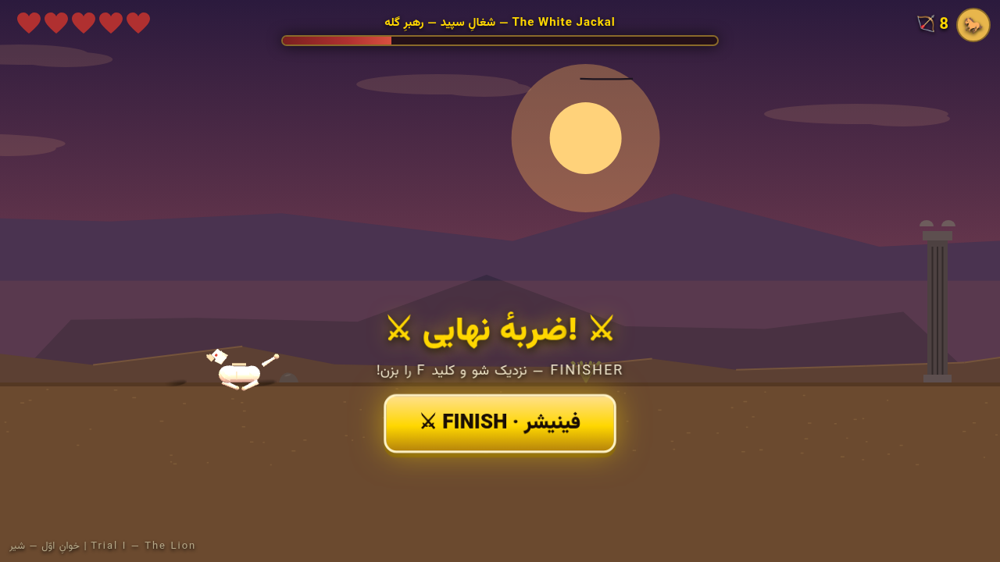
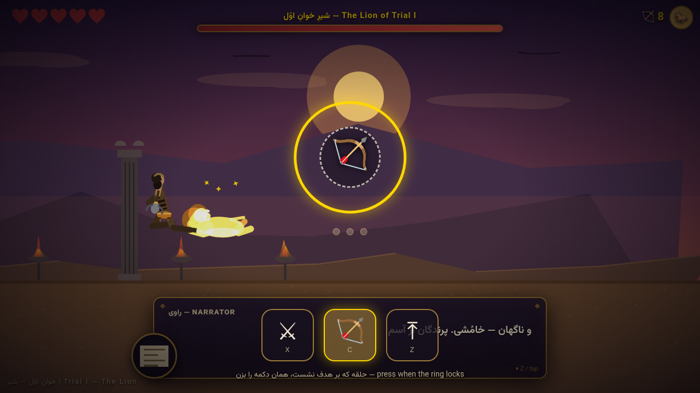
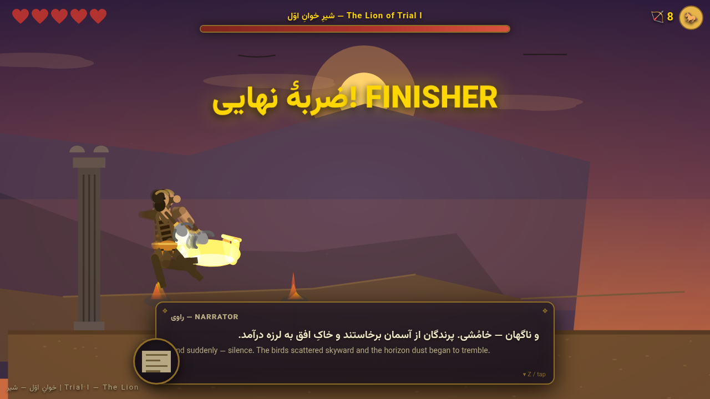
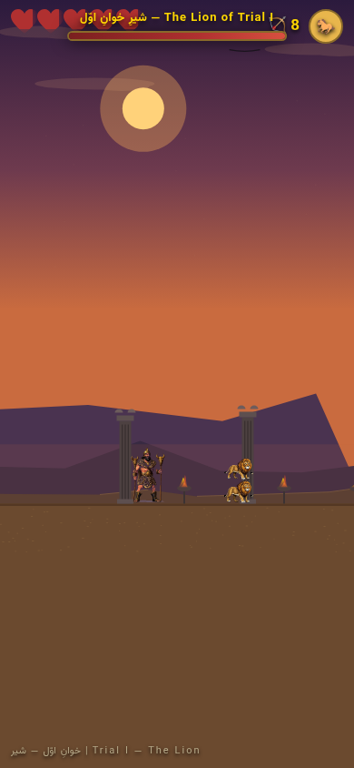

<div align="center">

▶️ **[PLAY NOW — بازی آنلاین](https://ssschangersss.github.io/The-Great-Rostam/)** ◀️


</div>

<div align="center">

> **EN** — An epic **frame-by-frame** action game about **Rostam**, the legendary hero of Ferdowsi's *Shahnameh*.
> Every hero and beast is a set of **hand-painted sprite-sheet frames** (no skeletal rigging at runtime) fighting inside a **hand-painted 2D world** — Trial I (**The Lion**) is fully playable in your browser, on **desktop or phone**, on a **fixed-timestep 60Hz simulation** with render interpolation.

> **FA** — یک بازی اکشن **فریم‌به‌فریم** حماسی درباره‌ی **رستم**، پهلوان شاهنامه‌ی فردوسی.
> قهرمان‌ها و هیولاها **انیمیشن فریم‌به‌فریم** با شیت‌های نقاشی‌شده هستند (بدون ریگ‌بندی در زمان اجرا) و در دنیای دوبعدیِ نقاشی‌شده می‌جنگند — خوانِ اوّل (**شیر**) کامل در مرورگر قابل بازی است — روی **دسکتاپ و موبایل** — با **شبیه‌سازی گام-ثابت ۶۰هرتز** و رندر درون‌یابی‌شده.

> ⚠️ **اقتباس آزاد**: این بازی بازآفرینی آزادِ خوانِ اوّل شاهنامه است؛ در متنِ شاهنامه در خوان نخست، **رخش** شیر را می‌کشد و رستم خواب است. نبرد مستقِم رستم و شیرِ این بازی، اقتباسی آزاد است — نه نقل دقیق. مرجعِ سرآغازِ روایت: [ابیات خوان اوّل (گنجور)](https://ganjoor.net/ferdousi/shahname/kkavoos/sh5).

</div>

---

## 🎬 Screenshots | تصاویر بازی

| Title | The Lion awaits |
|---|---|
|  |  |
| **⚔️ Finisher offer — the foe is on its knees** | **🎯 God-of-War-style QTE — press in time!** |
|  |  |
| **💥 The slam** | **📱 Mobile-first — touch controls** |
|  |  |

---

## ⚔️ What's inside | چه چیزی ساخته شده

- 🎞 **Frame-by-frame sprite engine (بدون ریگ‌بندی)** — every character is a library of **pre-drawn sprite-sheet frames** (Rostam ×12 clips, Lion ×8, White Jackal & Jackal ×6, Rakhsh ×2 — ~200 frames). Playback is **progress-locked to the combat state machine**, so hit frames, QTE windows and combo chains stay frame-accurate. White **hit-flash**, **enrage tint**, ghost **afterimages**, squash & stretch and death topple are composited per frame
- 🖌 **Identity-locked AI art pipeline** — each character has ONE canonical sheet; every other clip is **AI image-edit derived from it**, so the design never drifts off-model. Sheets are chroma-keyed, grid-clustered and feet-anchored by a build script (`scripts/`), then shipped as clean PNG frames
- ⚔️ **Shank-inspired combat** — lunging 3-hit mace combo, dodge **roll with i-frames**, air attack with hit-bounce, enemy hitstun & knockback friction (no ice-skating!), impact sparks, mace smear trails, hitstop, screen shake and a chain hit-counter
- 🎯 **Finisher QTE system (God of War style)** — bring a mini-boss or boss below its HP threshold and it **staggers**: approach and hit **F** (or the FINISH button) to enter a slow-motion ring-timed button sequence. Succeed → a cinematic leap-and-slam kill with afterimages. Miss twice → the beast **ENRAGES** (heals, red aura, faster & meaner)
- 🐺 **Mini-boss + Boss** — the **White Jackal, Pack Alpha** (summons its pack, triple-lunge chains) and the **Lion of Trial I** (pounce, claw combos, half-health roar shockwave) — each with its own finisher length & arena
- 📱 **Mobile-first design** — full-viewport adaptive canvas (any aspect ratio, DPR-aware), on-screen thumb controls (move / jump / mace / bow / roll / Rakhsh), coyote-time + jump buffering for forgiving touch play, tap-to-advance dialogue, fullscreen button, haptic feedback, one-time rotate hint
- 🏜 **Multi-layer parallax desert** — procedural mountains, dunes, drifting clouds, circling vultures, Achaemenid columns, animated braziers — all drawn in code
- 💬 **Bilingual dialogue system (FA/EN)** — typewriter effect, procedural pixel portraits, epic script in the spirit of the Shahnameh
- 🐎 **Rakhsh mount mechanic** — call the black stallion for a speed & trample boost
- 🏹 **Two weapon styles** — 3-hit mace combo with hitstop & screen shake, chargeable heroic bow
- 🔊 **Procedural WebAudio SFX** — every sound synthesized in code, no audio files
- 📊 **HTML/CSS UI layer** — hearts, arrow counter, Rakhsh cooldown radial, boss bar, chain counter, hurt vignette, QTE rings & feedback, title/pause/victory/defeat screens

## 🎯 The Finisher — ضربهٔ نهایی

When a **mini-boss or boss** is worn down to its threshold, it drops to its knees — dizzy, invulnerable, and offered to you:

1. **Approach** and press `F` / tap the golden **FINISH** button (you have ~4.5s)
2. The world slips into **slow motion** — a ring shrinks onto a target button (`⚔ X`, `🏹 C`, `⤒ Z`)
3. **Press the right button when the ring locks** — `PERFECT` timing hits harder
4. Chain every prompt (mini-boss: **2**, boss: **3**) → Rostam leaps and **ends it, Shahnameh-style**
5. Miss two prompts → the foe rises **ENRAGED**: partial heal, burning aura, faster attacks. Good luck.

> روی موبایل همان دکمه‌های روی صفحه را لمس کنید — حلقه که روی هدف نشست، دکمهٔ درست را بزن!

## 🕹 Controls | کنترل‌ها

**Desktop / دسکتاپ**

| Key | Action |
|---|---|
| `←` `→` / `A` `D` | Move / حرکت |
| `Z` / `Space` | Jump · advance dialogue / پرش · رد کردن دیالوگ |
| `X` | Mace combo (chain 3 hits) / ضربه‌ی سه‌تایی گرز |
| `C` (hold) | Charge & release arrow — quick tap = quick shot / نشانه‌گیری: کوتاه = تیر سریع، نگه‌داشتن = تیر شارژشده |
| `V` | **Dodge roll** (i-frames, cancels attack recovery) / **غلتک** (مصونیت + لغو بازیابی حمله) |
| `Shift` / `E` | Call Rakhsh (speed + **trample**) / فراخوان رخش (سرعت + سُم‌کوبی) |
| `F` | **Finisher** (on a staggered boss) / **ضربهٔ نهایی** |
| `Esc` | Pause (settings inside) / توقف (تنظیمات داخل منو) |
| `M` | Mute / بی‌صدا |
| `C` (on title) | Continue from checkpoint / ادامه از ایست بازرسی |

**Mobile / موبایل** — on-screen buttons: `◀ ▶` move · `⤒` jump · `⚔` mace · `🏹` bow · `🌀` roll · `🐎` Rakhsh · `⏸ 🔊 ⛶` system — plus the golden **FINISH** button and QTE pads when a boss kneels.

## 🚀 Run it | اجرا

**Option 1 — play online (easiest):** [ssschangersss.github.io/The-Great-Rostam](https://ssschangersss.github.io/The-Great-Rostam/)

**Option 2 — locally** (ES modules need a tiny server):

```bash
git clone https://github.com/SSSchangerSSS/The-Great-Rostam.git
cd The-Great-Rostam
python -m http.server 8000
# open http://localhost:8000
```

**On your phone:** open the same URL (or the GitHub Pages link) in any mobile browser — the touch UI appears automatically.

### Progress persistence | ماندگاری
- **Checkpoint** پس از شکست باس میانی ذخیره می‌شود؛ شکست → «تلاش مجدد از ایست بازرسی».
- **تنظیمات** (صدا، شدت لرزش، QTE آسان) روی صفحهٔ pause — هر دو با کلید نسخه‌دار localStorage و مدیریت خطا.
- URL param `?seed=123` — شبیه‌سازی gameplay را deterministic می‌کند (برای آزمون تکرارپذیر).

## 📁 Architecture | معماری ماژولار

```
The-Great-Rostam/
├── index.html                  # stage: painted 2D world canvas → sprite heroes → fx canvas + DOM UI
├── css/style.css               # mobile-first responsive UI (safe-area, adaptive HUD)
├── js/
│   ├── main.js                 # entry point + test hooks (window.__rostam / __rd)
│   ├── qte.js                  # ⚔ finisher system: offer → ring QTE → cinematic slam / enrage
│   ├── core/
│   │   ├── game.js             # FIXED-TIMESTEP loop (1/60 + accumulator + alpha), states, viewport
│   │   ├── input.js            # buffered action-mapped input (hitstop-safe, consume-once)
│   │   ├── camera.js           # smooth follow, shake, zoom, interpolation + view rect
│   │   ├── audio.js            # procedural WebAudio SFX (incl. QTE + slam)
│   │   └── utils.js            # math, easing, seeded RNG (mulberry32)
│   ├── gfx/
│   │   ├── sprites.js          # 🎞 frame-by-frame sprite bank: manifest loader, progress-locked
│   │   │                       #    playback, flash/tint compositing, alias clips (bow/jump subranges)
│   │   ├── rig.js              # animation state machine (clip names/timing — still drives sprite picks)
│   │   ├── paint.js            # prop painters + legacy procedural fallback painters
│   │   ├── particles.js        # pooled particle system (fx canvas)
│   │   └── parallax.js         # world-anchored 2D parallax environments, any aspect
│   ├── content/
│   │   ├── rigs.js             # combat-timing clip table (names & durations — sprites follow it)
│   │   ├── dialogues.js        # bilingual scripts (mini-boss + boss)
│   │   └── levels.js           # data-driven levels: waves, arenas, mini-boss, boss
│   ├── entities/
│   │   ├── player.js           # Rostam: combat, bow, mount, cinematic states
│   │   ├── enemies.js          # Jackal · WhiteJackal (mini-boss) · Lion (boss) — stagger/enrage
│   │   └── projectiles.js      # arrows
│   ├── world/
│   │   └── world.js            # AABB physics (one-way vs solid), props, triggers, pickups
│   ├── ui/
│   │   ├── hud.js              # hearts/arrows/cooldown/boss bar
│   │   ├── touch.js            # virtual controls, context switching, fullscreen, rotate hint
│   │   ├── dialogue.js         # typewriter dialogue system
│   │   └── menus.js            # title/pause(+settings)/victory/defeat
│   └── states/
│       ├── title.js  ├── play.js  └── results.js
├── tools/
│   └── animation-lab.html      # 🎞 sprite-sheet viewer + asset validator (runs on real sheets)
├── scripts/
│   └── node-logic-tests.mjs    # 20 engine logic tests (no browser needed)
└── docs/
    ├── AUDIT.md                # 🔍 evidence-based audit: severity/repro/cause/fix/regression
    ├── ASSET_PIPELINE.md       # sheet specs, loading contract, validation, missing assets
    ├── IMPLEMENTATION_STATUS.md# done / open / risks / next steps
    ├── GAME_DESIGN.md          # full design document (finisher, mobile & 2.5D renderer design)
    ├── MESHY_PROMPTS.md        # 🎨 ready-to-paste Meshy prompts for every character
    ├── screenshots/            # gameplay captures
    └── screenshots-test/       # automated browser-test captures (before/after evidence)
```

**Add a new trial in 3 steps:** a new entry in `levels.js` → a new palette in `parallax.js` → new dialogue in `dialogues.js`. Bosses declare their finisher in the level data (`finisherPrompts`, threshold) — the QTE engine handles the rest.

## 🎞 Sprite-Sheet Pipeline — خط تولید شیت‌های فریم‌به‌فریم

Every character's animations are **pre-drawn frames** packed as one sheet per clip: `assets/sprites/<char>/<clip>.png` (6×5 grid = 30 frames) + `manifest.json`. The runtime (`js/gfx/sprites.js`) picks the frame whose normalized progress matches the combat state machine — **no rigging, no skeletal animation at runtime; just a blit**. Roll & death motion is **baked into the frames** — no runtime rotation is stacked on top.

**Loading contract (honest fallback):** staged per-character loading; a failed sheet is retried once, recorded, and reported — a half-loaded character falls back to the **legacy procedural painters** as a whole, never invisible. Missing manifest ⇒ fully procedural game.

**Validate & inspect:** open `tools/animation-lab.html` (served from the repo root) — frame stepping, speed, flip, onion-skin, feet pivot, body/hurt/hit boxes, and a full asset validation pass (real image sizes vs manifest, blank-frame detection, feet-anchor check).

> Provenance of the current sheets: AI-generated & AI-edited (z-ai), art-directed for the game's Persian miniature palette. The sheet **build script of that earlier step is not part of this repository** — what IS reproducible here is the full validation tooling, the manifest mapping, and the fallback behavior (see [docs/ASSET_PIPELINE.md](docs/ASSET_PIPELINE.md)).
>
> Optional comeback path: the dormant `assets/meshy/` GLB drop-in loader can still bring AI **3D** models back later — prompts in [docs/MESHY_PROMPTS.md](docs/MESHY_PROMPTS.md) (note: `js/gfx/gl3d.js` is currently not wired into the module graph — dead code kept intentionally).

## ✅ Quality & docs | کیفیت و مستندات

- **Engine audit** با شواهد، بازتولید، علت، اصلاح و آزمون رگرسیون: [docs/AUDIT.md](docs/AUDIT.md)
- **وضعیت پیاده‌سازی** (انجام‌شده/باز/ریسک/قدم بعد): [docs/IMPLEMENTATION_STATUS.md](docs/IMPLEMENTATION_STATUS.md)
- **خط تولید دارایی**: [docs/ASSET_PIPELINE.md](docs/ASSET_PIPELINE.md)
- **آزمون‌های منطق (Node, بدون مرورگر):** `node scripts/node-logic-tests.mjs` — تعیین‌پذیری شبیه‌سازی، برخورد one-way/solid، تیر swept، زنجیرهٔ triple باس میانی، بازنشانی Director، اصطکاک knockback، بافر ورودی
- **آزمون مرورگر:** قلاب‌های `window.__rd` (مسیر واقعی بازی، بدون shortcut پیروزی) + اسکرین‌شات‌های `docs/screenshots-test/`
- محیط اندازه‌گیری آخرین اجرا: headless Chromium 144، localhost، 1280×720 — **58–60 FPS، simMs≈۰٫۵۸، drawMs≈۰٫۱۶** (`__rostam.stats` زنده)

---

## 🗺 Roadmap | نقشه راه

- [x] Web engine: rig animation, parallax, physics, dialogue, audio — **موتور وب کامل**
- [x] Trial I — The Lion (playable!) — **خوان اوّل: شیر**
- [x] ~~2.5D Three.js pass~~ → replaced by frame-by-frame sprite sheets — **جایگزین‌شده با انیمیشن فریم‌به‌فریم**
- [x] **Meshy-AI drop-in pipeline** (assets/meshy/*.glb → auto-swap) — **پایپ‌لاین مدل‌های هوش مصنوعی**
- [x] Mini-boss (White Jackal) + **God-of-War-style finisher QTEs** — **ضربه‌های نهایی**
- [x] **Mobile-first** touch controls + responsive canvas — **کنترل لمسی موبایل**
- [ ] Trial II — The Burning Desert (night palette ready) — بیابان سوزان
- [ ] Trial III — The Dragon — اژدها
- [ ] Trials IV–VII — جادوگر تا دیو سپید
- [ ] Gamepad support — پشتیبانی دسته

---

## 📜 License | مجوز

[MIT](LICENSE) — *Shahnameh belongs to everyone; this game belongs to its contributors.*

*شاهنامه مال همه است؛ این بازی مال سازندگانش.*
