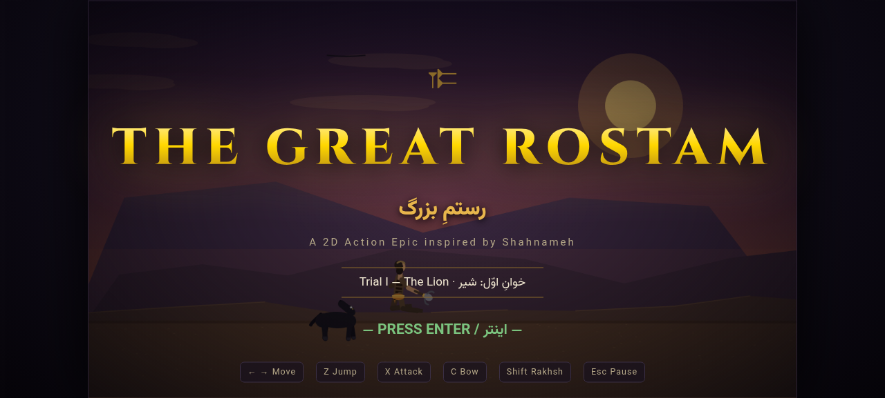
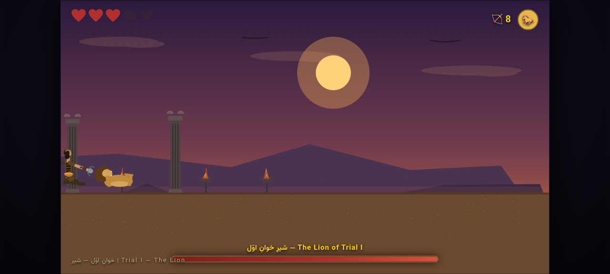
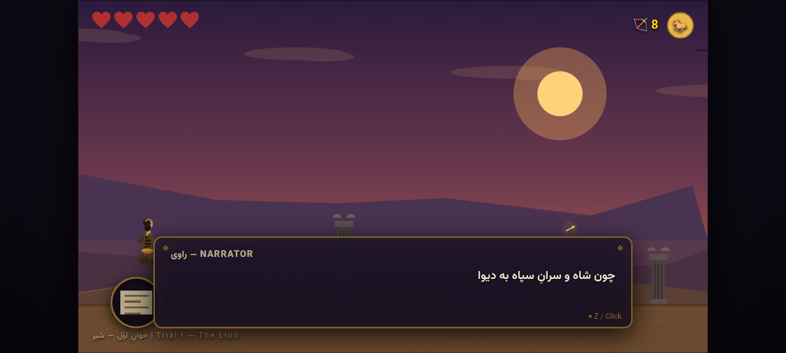
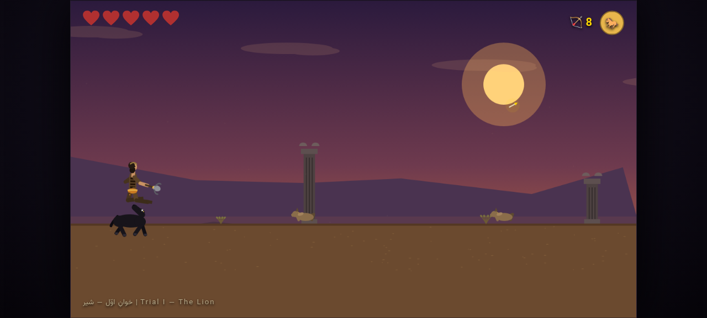

<div align="center">

▶️ **[PLAY NOW — بازی آنلاین](https://ssschangersss.github.io/The-Great-Rostam/)** ◀️


</div>

<div align="center">

> **EN** — An epic 2D action game about **Rostam**, the legendary hero of Ferdowsi's *Shahnameh*.
> Trial I (**The Lion**) is fully playable in your browser — **100% procedural graphics, zero image assets**.

> **FA** — یک بازی اکشن دوبعدی حماسی درباره‌ی **رستم**، پهلوان شاهنامه‌ی فردوسی.
> خوانِ اوّل (**شیر**) به‌طور کامل در مرورگر قابل بازی است — **تمام گرافیک پروسیجرال، بدون هیچ فایل تصویری**.

</div>

---

## 🎬 Screenshots | تصاویر بازی

| Title | Boss Fight |
|---|---|
|  |  |
| **Dialogue System** | **Rakhsh Mount** |
|  |  |

---

## ⚔️ What's inside | چه چیزی ساخته شده

- 🦴 **Procedural skeletal rig system** — Rostam, Rakhsh, the Lion and Jackals are animated bone-by-bone (11–12 bones each, keyframed clips: idle / run / jump / 3-hit combo / bow / pounce / roar / death)
- 🏜 **Multi-layer parallax desert** — procedural mountains, dunes, drifting clouds, circling vultures, Achaemenid columns, animated braziers — all drawn in code
- 💬 **Bilingual dialogue system (FA/EN)** — typewriter effect, procedural pixel portraits, epic script in the spirit of the Shahnameh
- 🐎 **Rakhsh mount mechanic** — call the black stallion for a speed & trample boost
- 🏹 **Two weapon styles** — 3-hit mace combo with hitstop & screen shake, chargeable heroic bow
- 🦁 **Boss AI** — the Lion: prowl → telegraphed crouch → pounce → claw swipe, enrage roar at half health, arena lock
- 🔊 **Procedural WebAudio SFX** — every sound synthesized in code, no audio files
- 📊 **HTML/CSS UI layer** — hearts, arrow counter, Rakhsh cooldown radial, ornate boss bar, title/pause/victory/defeat screens

## 🕹 Controls | کنترل‌ها

| Key | Action |
|---|---|
| `←` `→` / `A` `D` | Move / حرکت |
| `Z` / `Space` | Jump · advance dialogue / پرش · رد کردن دیالوگ |
| `X` | Mace combo (chain 3 hits) / ضربه‌ی سه‌تایی گرز |
| `C` (hold) | Charge & release arrow / نشانه‌گیری و شلیک تیر |
| `Shift` | Call Rakhsh / فراخوان رخش |
| `Esc` | Pause / توقف |
| `M` | Mute / بی‌صدا |

## 🚀 Run it | اجرا

**Option 1 — play online (easiest):** [ssschangersss.github.io/The-Great-Rostam](https://ssschangersss.github.io/The-Great-Rostam/)

**Option 2 — locally** (ES modules need a tiny server):

```bash
git clone https://github.com/SSSchangerSSS/The-Great-Rostam.git
cd The-Great-Rostam
python -m http.server 8000
# open http://localhost:8000
```

## 📁 Architecture | معماری ماژولار

```
The-Great-Rostam/
├── index.html                  # canvas + DOM UI layers
├── css/style.css               # HUD, dialogue box, menus (Persian-gold theme)
├── js/
│   ├── main.js                 # entry point
│   ├── core/
│   │   ├── game.js             # loop, state machine, shared systems
│   │   ├── input.js            # action-mapped keyboard/mouse
│   │   ├── camera.js           # smooth follow + shake
│   │   ├── audio.js            # procedural WebAudio SFX
│   │   └── utils.js            # math, easing, seeded RNG
│   ├── gfx/
│   │   ├── rig.js              # skeletal animation engine (bones/clips/animator)
│   │   ├── paint.js            # character & prop painters (rostam/lion/rakhsh/jackal…)
│   │   ├── particles.js        # pooled particle system
│   │   └── parallax.js         # procedural environments & palettes
│   ├── content/
│   │   ├── rigs.js             # rig + animation clip definitions
│   │   ├── dialogues.js        # bilingual scripts
│   │   └── levels.js           # data-driven level definitions
│   ├── entities/
│   │   ├── player.js           # Rostam: combat, bow, mount
│   │   ├── enemies.js          # Lion boss AI + Jackal
│   │   └── projectiles.js      # arrows
│   ├── world/
│   │   └── world.js            # physics, props, triggers, pickups
│   ├── ui/
│   │   ├── hud.js              # hearts/arrows/cooldown/boss bar
│   │   ├── dialogue.js         # typewriter dialogue system
│   │   └── menus.js            # title/pause/victory/defeat
│   └── states/
│       ├── title.js  ├── play.js  └── results.js
└── docs/
    ├── GAME_DESIGN.md          # full design document
    └── screenshots/            # gameplay captures
```

**Add a new trial in 3 steps:** a new entry in `levels.js` → a new palette in `parallax.js` → new dialogue in `dialogues.js`. The engine handles the rest.

## 🗺 Roadmap | نقشه راه

- [x] Web engine: rig animation, parallax, physics, dialogue, audio — **موتور وب کامل**
- [x] Trial I — The Lion (playable!) — **خوان اوّل: شیر**
- [ ] Trial II — The Burning Desert (night palette ready) — بیابان سوزان
- [ ] Trial III — The Dragon — اژدها
- [ ] Trials IV–VII — جادوگر تا دیو سپید
- [ ] Mobile touch controls — کنترل لمسی موبایل
- [ ] Gamepad support — پشتیبانی دسته

---

## 📜 License | مجوز

[MIT](LICENSE) — *Shahnameh belongs to everyone; this game belongs to its contributors.*

*شاهنامه مال همه است؛ این بازی مال سازندگانش.*
